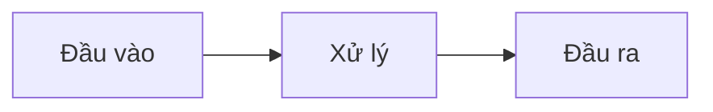

# Flow tái tạo: <tên sản phẩm>

Nguồn: <bài, ngày>. Phần nào là đoán thì ghi (đoán).

## Bài thật ra bán gì

## Sơ đồ

## Từng khối

| Claim | Đầu vào | Xử lý | Công cụ/model | Đầu ra |
|---|---|---|---|---|

## Điều kiện ẩn người bán tự nhận
