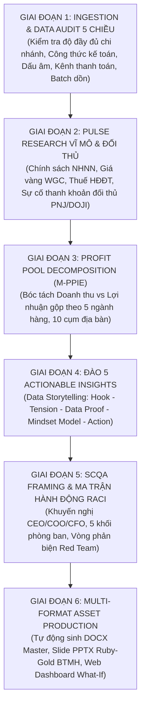

# BTMH MONTHLY RETAIL INTELLIGENCE & MCKINSEY STRATEGY SOP
> **Chuẩn mực:** Antigravity Enterprise Business Intelligence & McKinsey Strategic Framework  
> **Ứng dụng:** Vận hành định kỳ vào ngày 03 - 05 hàng tháng để tổng kết chu kỳ kinh doanh tháng trước, dự phóng kịch bản tháng tiếp theo và trình Ban Tổng Giám đốc BTMH.

---

## 1. TỔNG QUAN KHUNG VẬN HÀNH 6 GIAI ĐOẠN (6-PHASE MONTHLY BI CYCLE)

---

## 2. CHI TIẾT QUY TRÌNH THỰC THI CHUẨN (STANDARD OPERATING PROCEDURE)

### GIAI ĐOẠN 1: TIẾP NHẬN DỮ LIỆU & KIỂM TOÁN CHẤT LƯỢNG (AUTOMATED DATA AUDIT)
Trước khi đưa vào mô hình tính toán, Agent bắt buộc phải chạy thuật toán quét **05 Bẫy Dữ Liệu**:
1. **Kiểm tra Độ Đầy Đủ Danh Mục Điểm Bán (Store Completeness Check):**
   * Đối soát danh sách cửa hàng phát sinh doanh thu với Master Data hệ thống (từ `BTMH_001` đến `BTMH_078`).
   * Phân biệt rõ ràng giữa *Cửa hàng mới mở chưa kích hoạt mã* vs *Lỗi đứt gãy đường truyền ETL*.
2. **Kiểm tra Bảo Toàn Công Thức Kế Toán (Financial Consistency):**
   * Kiểm tra điều kiện: `| Doanh_Thu_Thuan_VND - Gia_Von_COGS_VND - Loi_Nhuan_Gop_VND | <= 1.0 VNĐ`.
   * Kiểm tra: `| (Loi_Nhuan_Gop_VND / Doanh_Thu_Thuan_VND * 100) - Ty_Suat_Loi_Nhuan_Gop_% | <= 0.05%`.
   * Cô lập các giao dịch có độ chênh lệch bất thường (như lỗi dồn đơn, hoàn cọc giữ chỗ).
3. **Kiểm tra Ràng Buộc Dấu & Giá Trị Hợp Lệ (Sign & Domain Integrity):**
   * Báo động đỏ nếu `Khach_Hang_Moi < 0`, `Khach_Hang_Quay_Lai < 0`, hoặc `San_Luong_Ban < 0`.
   * Nhận diện lỗi nhập nhầm số lượng hàng đổi trả bảo hành vào cột khách hàng mới.
4. **Kiểm tra Bảo Toàn Tỷ Trọng Kênh Thanh Toán (Payment Distribution Integrity):**
   * Kiểm tra: `| (Ty_Le_CK_% + Ty_Le_Tien_Mat_% + Ty_Le_POS_%) - 100.0% | <= 0.1%`.
   * Nếu lệch > 0.1%, tự động phân tách số liệu sang nhóm thanh toán hỗn hợp (Voucher, điểm thành viên, cấn trừ công nợ).
5. **Kiểm tra Đột Biến AOV & Nghẽn Mạng Giờ Cao Điểm (Spike & POS Anomaly):**
   * So sánh AOV của từng dòng sản phẩm tại mỗi cửa hàng với trung vị (Median AOV) của cụm địa bàn.
   * Nếu AOV > 300% trung vị kèm số giao dịch sụt giảm > 50%, gắn cờ "Lỗi gộp đơn do mất mạng POS cục bộ".

---

### GIAI ĐOẠN 2: THU THẬP TÍN HIỆU THỊ TRƯỜNG & ĐỐI THỦ (MACRO & COMPETITOR PULSE)
Agent sử dụng công cụ tìm kiếm và cơ sở dữ liệu chuyên ngành để đối chiếu các sự kiện thực tế trong tháng:
1. **Biến động Vĩ mô & Giá vàng:**
   * Diễn biến giá vàng giao ngay quốc tế (Kitco/WGC) và giá vàng miếng SJC, vàng nhẫn trơn 999.9 trong nước.
   * Chênh lệch giá trong nước - quốc tế và tác động của tỷ giá USD/VND.
2. **Khung Pháp lý & Chính sách Quản lý:**
   * Cập nhật chỉ đạo mới nhất từ Ngân hàng Nhà nước (Dự thảo sửa đổi Nghị định 24, Thông tư quản lý trạng thái vàng).
   * Yêu cầu thanh tra hóa đơn điện tử khởi tạo từ máy tính tiền và chế tài giao dịch thanh toán không dùng tiền mặt > 20 triệu VNĐ.
3. **Động thái Đối thủ Cạnh tranh (Competitive Intelligence):**
   * Động thái thay đổi chính sách thu đổi, thanh toán của PNJ, DOJI, SJC, Bảo Tín Minh Châu.
   * Các chiến dịch Marketing, khuyến mại mùa vụ hoặc khủng hoảng truyền thông của đối thủ để chớp thời cơ chuyển dịch thị phần.

---

### GIAI ĐOẠN 3: PHÂN RÃ BỂ LỢI NHUẬN THEO MÔ HÌNH M-PPIE
Agent thực thi ma trận tính toán 2 chiều:
* **Chiều Dòng Sản Phẩm (5 danh mục):**
  1. `GOLD_ACCUM`: Vàng tích trữ 999.9 (Nhẫn tròn trơn, Thẻ vàng) -> Đánh giá vai trò Phễu lưu lượng (Traffic Magnet).
  2. `GOLD_24K_JEW`: Vàng trang sức 24K truyền thống & Phong thủy -> Biên gộp mục tiêu 9% - 12%.
  3. `KIM_GIA_BAO_GIFT`: Quà tặng mỹ nghệ mạ vàng, Tranh vàng -> **Mỏ vàng lợi nhuận 1 (Biên 25% - 30%)**.
  4. `JEW_18K_GEM`: Trang sức thời trang 18K/14K đá quý, kim cương -> **Mỏ vàng lợi nhuận 2 (Biên 30% - 35%)**.
  5. `SILVER_ACCUM`: Bạc tích lũy & trang sức bạc BTMH -> Nhóm khách hàng trẻ nhập môn.
* **Chiều Cụm Địa Bàn (10 cụm):**
  * Đánh giá hiệu suất Doanh thu/CH và Lợi nhuận gộp/CH giữa nhóm Flagship Nội đô (Cụm 1, 2) vs Cụm Đô thị mới (Cụm 5, 6) vs Cụm Duyên hải - Đồng bằng công nghiệp (Cụm 8, 9).

---

### GIAI ĐOẠN 4: ĐÀO SÂU TỐI THIỂU 05 ACTIONABLE INSIGHTS CHUẨN MCKINSEY
Mỗi insight bắt buộc cấu trúc theo **Công thức Data Storytelling 5 Thành Tố**:
1. **Hook (Tiêu đề hành động):** Nêu bật hiện tượng gây chú ý kèm số liệu tương phản.
2. **Tension (Xung đột kinh doanh):** Mâu thuẫn giữa kỳ vọng doanh số và thực tế sinh lời/rủi ro.
3. **Data Proof (Bằng chứng số liệu):** Bảng số liệu hoặc tỷ lệ % chính xác được kiểm toán từ dataset.
4. **Mindset Framework (Mô hình tư duy):** Trích dẫn lý thuyết kinh điển (Profit Pool, Strategic Inflection, Trust Moat, TAM, Cluster Advantage) kèm nguồn đối sánh (PNJ, WGC, NHNN).
5. **Actionable Directive (Chỉ thị hành động):** Ai làm gì, chỉ tiêu định lượng thế nào, mang lại bao nhiêu tỷ VNĐ.

---

### GIAI ĐOẠN 5: BẢN KHUYẾN NGHỊ SCQA & PHÂN QUYỀN TRÁCH NHIỆM RACI
* **Cấu trúc SCQA:**
  * *Situation:* Thành tựu quy mô và vị thế hiện tại của chuỗi BTMH.
  * *Complication:* Các thách thức về bẫy quy mô, siết chặt hóa đơn và biến động thị trường.
  * *Question:* Câu hỏi cốt tử gửi đến Hội đồng Quản trị & Ban Tổng Giám đốc.
  * *Answer:* Bộ giải pháp chiến lược (Chiến lược Kiềng 3 Chân).
* **Ma trận RACI 5 Khối chức năng:**
  * `Ban Tổng Giám đốc (CEO/COO/CFO)`: Phê duyệt mục tiêu biên lợi nhuận, cơ cấu vốn lưu động.
  * `Khối Kinh doanh & Bán lẻ (Retail Ops)`: Đào tạo cross-sell, phân luồng quầy giao dịch, chuẩn hóa quy trình thu mua tiền mặt.
  * `Khối Marketing & Quản trị Sản phẩm`: Triển khai 3 chiến dịch trọng điểm mùa vụ, thiết kế gói quà tặng doanh nghiệp B2B.
  * `Khối Tài chính - Kế toán & Quản trị Rủi ro`: Điều tiết hạn mức thanh khoản tiền mặt, phòng hộ giá vàng (Hedging).
  * `Khối Công nghệ Thông tin & Số Hóa`: Tự động hóa hóa đơn điện tử qua Dynamic QR, cơ chế Offline POS.
* **Vòng Phản Biện Red Team:**
  * Luận điểm phản biện của CFO (Rủi ro quay vòng tồn kho trang sức) & Giải pháp Lean JIT.
  * Luận điểm phản biện của Pháp chế (Rủi ro thu mua tiền mặt trên 20 triệu) & Giải pháp Fast Transfer 60 giây + CCCD gắn chip.

---

### GIAI ĐOẠN 6: TỰ ĐỘNG XUẤT BẢN 3 ẤN PHẨM BÀN GIAO (MULTI-FORMAT ASSET FACTORY)
Agent tự động chạy các script xử lý để sinh ra trọn bộ file:
1. `Bao_Cao_Chuyen_Sau_[Thang].docx`: Báo cáo Word học thuật đầy đủ bảng biểu, định dạng thanh lịch, typography sắc nét.
2. `Slide_Trinh_Bay_[Thang].pptx`: Slide deck trình bày Ban Lãnh đạo chuẩn màu thương hiệu BTMH (Đỏ Ruby `#8B0000`, Vàng Gold `#D4AF37`, Navy `#0F172A`).
3. `web_dashboard/index.html`: Website tương tác Single-Page Application (SPA) tích hợp Chart.js, Tailwind CSS và Bộ điều khiển mô phỏng "What-If" chạy offline không cần cài đặt.

---

## 3. CHECKLIST KIỂM ĐỊNH CHẤT LƯỢNG (QUALITY GATEWAY)
Trước khi hoàn tất turn, Agent phải xác nhận đạt 100% các tiêu chí sau:
- [ ] Không bỏ sót bất kỳ cửa hàng nào trong phạm vi 76-78 cửa hàng.
- [ ] Mọi con số doanh thu, COGS, lợi nhuận gộp trong báo cáo khớp tuyệt đối với kết quả tính toán của Python.
- [ ] Tối thiểu 5 Actionable Insights đều có trích dẫn lý thuyết và đề xuất số liệu gia tăng lợi nhuận cụ thể.
- [ ] File DOCX và PPTX mở ra không bị lỗi định dạng, không vỡ layout bảng.
- [ ] Website HTML mở được trên mọi trình duyệt với các thanh trượt What-If hoạt động mượt mà.
