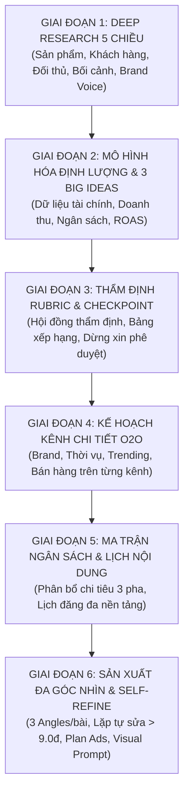
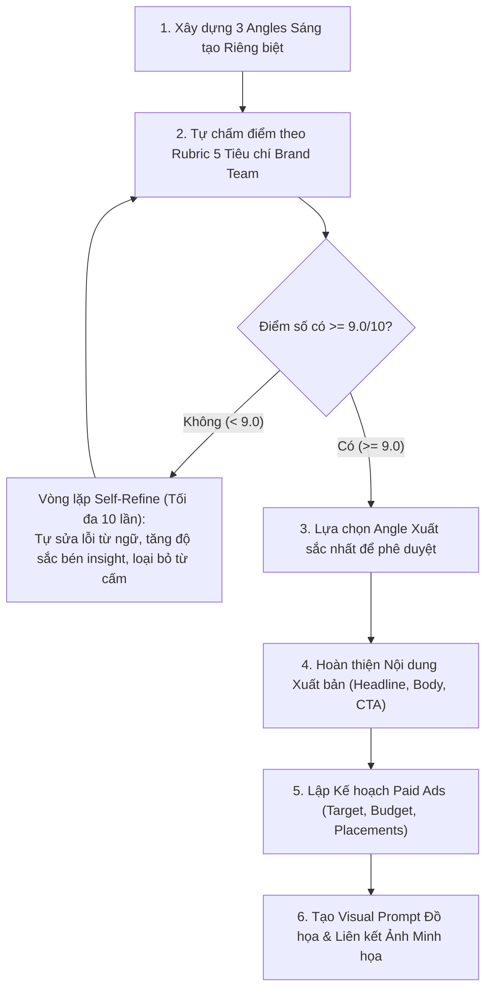

# ENTERPRISE IMC CAMPAIGN CREATOR & CONTENT PRODUCTION FRAMEWORK
> **Quy chuẩn:** Agentic Marketing & Content Automation Framework  
> **Ứng dụng:** Xây dựng chiến lược IMC trung và dài hạn, mùa vụ cao điểm (Tết, Lễ hội, Ra mắt sản phẩm), kết hợp tư duy tài chính định lượng và sản xuất nội dung quy mô lớn.

---

## 1. TỔNG QUAN KHUNG CHIẾN LƯỢC 6 GIAI ĐOẠN (6-PHASE IMC SOP)

---

## 2. CHI TIẾT THỰC THI TỪNG GIAI ĐOẠN

### GIAI ĐOẠN 1: BỘ 5 HỒ SƠ DEEP RESEARCH ĐỘC LẬP
Trước khi đề xuất bất kỳ ý tưởng sáng tạo nào, Agent bắt buộc phải thực hiện nghiên cứu chuyên sâu dựa trên số liệu thực tế và lưu thành các tài liệu độc lập:

1. **Hồ sơ 1: Nghiên cứu Dòng sản phẩm & Cấu trúc Tài chính:**
   - Phân tích toàn bộ danh mục SKU: Quy cách, Giá niêm yết, Giá vốn (COGS), Tỷ suất lợi nhuận gộp (Gross Margin %).
   - Đánh giá vai trò từng nhóm theo ma trận BCG: *Volume Drivers / Phễu hút khách* vs. *Profit Drivers / Siêu lợi nhuận* vs. *Penetration / Dễ mua*.
   - Khảo sát doanh thu, lợi nhuận gộp thực tế các kỳ trước từ dữ liệu nội bộ.
2. **Hồ sơ 2: Chân dung Khách hàng & Hành vi Tiêu thụ Số:**
   - Xây dựng 3-5 Buyer Personas rõ nét: Nhân khẩu học, Nỗi đau sâu kín (Pain points), Động lực mua sắm (Gain drivers).
   - Bản đồ hành vi tiêu thụ số: Kênh ưa chuộng, Khung giờ vàng online, Định dạng nội dung hấp dẫn, Tỷ lệ phương thức thanh toán (VietQR, Tiền mặt, Thẻ).
3. **Hồ sơ 3: Ma trận Đối thủ Cạnh tranh & Lỗ hổng Chiến lược:**
   - Lập bảng so sánh 3-5 đối thủ trực tiếp và gián tiếp.
   - Chỉ ra điểm mạnh nổi bật và ĐIỂM YẾU CHÍ MẠNG / KHỦNG HOẢNG gần nhất của từng đối thủ.
   - Xác lập *Bộ đòn bẩy phản công độc quyền* của doanh nghiệp.
4. **Hồ sơ 4: Bối cảnh Mùa vụ, Pháp lý & Lạm phát Quảng cáo:**
   - Nhận diện các làn sóng nhu cầu theo chu kỳ thời gian.
   - Dự báo biến động giá thầu quảng cáo (CPM, CPC) và chính sách kiểm duyệt của nền tảng (Meta, TikTok, Google).
   - Đánh giá hiệu quả lịch sử của từng kênh truyền thông: Chi phí, Doanh thu, ROAS, CPA, Tỷ lệ chốt đơn (Conversion Rate).
5. **Hồ sơ 5: Brand Voice & Bộ Quy chuẩn Tuân thủ (Compliance Rules):**
   - Visual Identity: Bảng màu chuẩn (Mã HEX Primary, Secondary, Background), Typography, Phong cách hình ảnh.
   - Tone of Voice: Giọng điệu chủ đạo, quy tắc xưng hô thương hiệu - khách hàng.
   - **BỘ 4 ĐIỀU CẤM KỴ TUYỆT ĐỐI (RED LINES):** Cấm cam kết lợi nhuận/giá đầu cơ; Cấm dùng từ ngữ lướt sóng; Tuân thủ 100% luật pháp chuyên ngành; Không công kích hạ bệ đối thủ trực tiếp.

---

### GIAI ĐOẠN 2: MÔ HÌNH HÓA ĐỊNH LƯỢNG & ĐỀ XUẤT 3 BIG IDEAS
Tuyệt đối không đưa ra các con số cảm tính. Mọi mục tiêu phải được mô hình hóa theo công thức:

$$\text{Ngân sách Marketing} = \text{Doanh thu Mục tiêu} \times \text{Tỷ lệ Ngân sách Ngành (\%)} \quad (2.0\% - 3.5\%)$$

$$\text{ROAS Mục tiêu} = \frac{\text{Doanh thu Mục tiêu}}{\text{Ngân sách Marketing}}$$

$$\text{Lợi nhuận Gộp Dự kiến} = \text{Doanh thu Mục tiêu} \times \text{Biên Lợi nhuận Gộp Danh mục (\%)} $$

Đề xuất **3 Phương án IMC** với 3 góc tiếp cận (Angles) hoàn toàn khác biệt:
- **Phương án A:** Góc độ Di sản, Niềm tin & Giá trị Thật (Heritage & Absolute Trust Focus).
- **Phương án B:** Góc độ Biểu tượng Văn hóa, Khát vọng & Đột phá Công nghệ (Culture & Innovation Focus).
- **Phương án C:** Góc độ Tiện nghi Trải nghiệm & Xóa bỏ Rào cản Mua sắm (Frictionless Commerce & Service Focus).

Mỗi phương án phải bao gồm: Big Idea, Core Insight, 3 Trụ cột thông điệp, Sản phẩm mũi nhọn, Lộ trình 3 giai đoạn (Phase 1 Warm-up -> Phase 2 Peak 1 -> Phase 3 Peak 2), và Bảng phân bổ ngân sách 7-8 kênh.

---

### GIAI ĐOẠN 3: CƠ CHẾ CHẤM ĐIỂM RUBRIC & CHECKPOINT PHÊ DUYỆT
Thành lập Hội đồng Thẩm định Chiến lược ảo (đóng vai CMO, CFO, Giám đốc Vận hành, Giám đốc Pháp chế) để chấm điểm trên Rubric 5 tiêu chí:

| Tiêu chuẩn Thẩm định | Trọng số | Thang điểm | Câu hỏi Kiểm tra Cốt lõi |
|:---|:---:|:---:|:---|
| **1. Chuẩn mực Thương hiệu & Brand Guideline** | **25%** | 25 điểm | Có giữ đúng giọng điệu cốt lõi? Có tuân thủ tuyệt đối 4 Điều Cấm Kỵ? Có chuẩn mã màu? |
| **2. Độ sắc bén Insight & Sức hút Văn hóa** | **20%** | 20 điểm | Có chạm đúng nỗi đau sâu kín? Có cộng hưởng với tâm lý xã hội thời điểm? |
| **3. Tính Khả thi Sinh lời Thương mại** | **25%** | 25 điểm | Có đạt doanh thu & bảo vệ biên lợi nhuận gộp mục tiêu? Cân bằng Volume vs Profit? |
| **4. Hiệu quả Hiệp đồng Đa kênh O2O** | **15%** | 15 điểm | Có tối ưu Owned Media? Có kéo traffic online về điểm bán offline thông suốt? |
| **5. Quản trị Rủi ro & Vận hành Khả thi** | **15%** | 15 điểm | Có phương án chống nghẽn dịch vụ, chống đứt gãy cung ứng, an toàn pháp lý? |

> [!IMPORTANT]
> **CHECKPOINT BẮT BUỘC (HUMAN-IN-THE-LOOP):**  
> Sau khi xuất Bảng xếp hạng và Đề xuất "Dung hợp Tinh hoa" (Hybrid Strategy), Agent **BẮT BUỘC DỪNG LẠI** để người dùng lựa chọn phương án trước khi triển khai Giai đoạn 4, 5, 6!

---

### GIAI ĐOẠN 4: KẾ HOẠCH TRUYỀN THÔNG CHI TIẾT TỪNG KÊNH
Từ phương án được chọn, xây dựng kế hoạch hành động cụ thể cho từng kênh trong hệ sinh thái (POSM cửa hàng, Zalo OA VIP, Facebook/Insta, Google/YouTube, TikTok, PR Báo chí, Trade Activation, Website):
- **Brand (Thương hiệu):** Yếu tố di sản, niềm tin, định vị được cài cắm ra sao?
- **Thời vụ (Seasonality):** Tương thích với nhịp sinh hoạt và lễ hội từng tuần như thế nào?
- **Trending:** Bắt nhịp các trào lưu số, hashtag challenge, minigame, công nghệ tương tác AR/QR.
- **Bán hàng (Sales):** SKU trọng điểm, chính sách ưu đãi, cổng đặt trước, phân làn phục vụ nhanh.

---

### GIAI ĐOẠN 5: MA TRẬN PHÂN BỔ NGÂN SÁCH & LỊCH NỘI DUNG ĐA KÊNH
1. **Phân bổ ngân sách theo 3 giai đoạn (Phase 1 -> Phase 2 -> Phase 3)** và theo hạng mục chi phí (Paid Media, Sản xuất Media, KOCs/PR, Thi công điểm bán, Công nghệ hạ tầng).
2. **Kiến trúc 4 Trụ cột Nội dung (Content Pillars):**
   - Pillar 1: Brand Heritage & Absolute Trust (25%)
   - Pillar 2: Cultural Symbolism & Emotional Storytelling (30%)
   - Pillar 3: Product Showcase & Frictionless Commerce (30%)
   - Pillar 4: Trending, Lifestyle & Engagement (15%)
3. **Lập bảng ma trận lịch phát sóng chi tiết:**
   - Mạng xã hội hàng ngày (Facebook / Instagram) trong 30 - 45 ngày cao điểm.
   - Video ngắn TikTok & Shorts YouTube hàng tuần (12 - 16 tuần).
   - Tuyến bài viết chuẩn SEO Website (3 bài/tuần).

---

### GIAI ĐOẠN 6: SẢN XUẤT ĐA GÓC NHÌN & VÒNG LẶP SELF-REFINE (> 9.0 ĐIỂM)

Mỗi nội dung sản xuất (Bài viết, Kịch bản video, Bài SEO) phải trải qua quy trình nghiêm ngặt:

#### Cấu trúc Hồ sơ một Bài đăng Hoàn chỉnh:
1. **Mã bài & Lịch đăng:** ID, Ngày phát sóng, Khung giờ vàng tối ưu.
2. **Kế hoạch Paid Ads:** Mục tiêu chiến dịch, Ngân sách ngày/tuần, Tệp đối tượng target (Địa lý, Tuổi, Sở thích, Hành vi), Vị trí hiển thị (Placements).
3. **3 Angles Đề xuất:** Tóm tắt ý tưởng của 3 góc tiếp cận khác nhau.
4. **Bảng Chấm điểm & Nhật ký Self-Refine:** Ghi nhận điểm từng angle, lịch sử lặp sửa lỗi, bảo đảm angle được chọn đạt **>= 9.0 / 10 điểm**.
5. **Nội dung Caption Xuất bản:** Headline giật tít trang trọng, Thân bài giàu cảm xúc, gạch đầu dòng rõ ràng, CTA thúc đẩy hành động, Hashtags chuẩn.
6. **Visual Prompt & Asset:** Mô tả chi tiết cho Designer/AI Generator (Góc máy, Bố cục, Ánh sáng, Màu thương hiệu, Sản phẩm thật) + Tệp ảnh minh họa đính kèm.

---

## 3. CÁC NGUYÊN TẮC CỐT TỬ CẦN GHI NHỚ

1. **Không nói chung chung:** Luôn trích dẫn số liệu cụ thể (Doanh thu, Lợi nhuận gộp, Số lượt khách, Tỷ lệ %, CPA, ROAS). Nếu chưa có số liệu, phải giải trình logic tư duy mô hình hóa.
2. **Bảo toàn Kỷ luật Thương hiệu:** Không bao giờ đánh đổi phẩm giá thương hiệu lấy lượt xem giật gân rẻ tiền. Tuyệt đối không phạm vào 4 Điều Cấm Kỵ.
3. **Tính Thực thi Tuyệt đối:** Mọi cam kết trên truyền thông phải gắn liền với năng lực phục vụ của chuỗi cửa hàng vật lý và hệ thống hậu cần (Logistics/Inventory).
